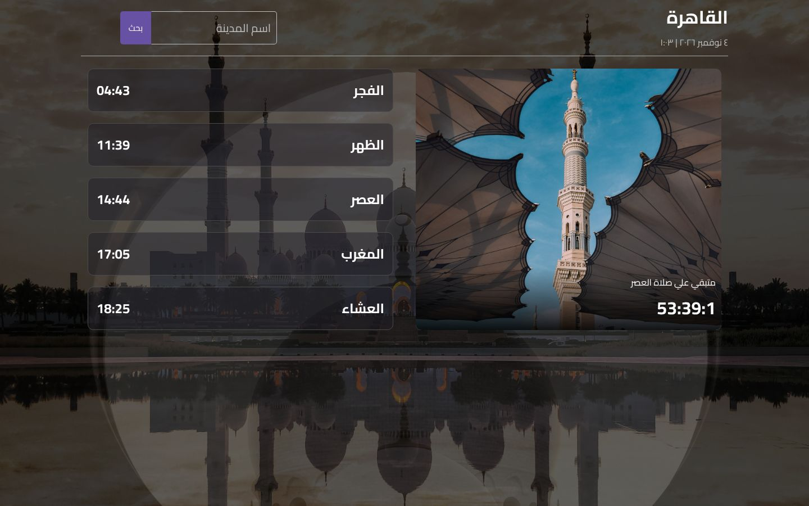
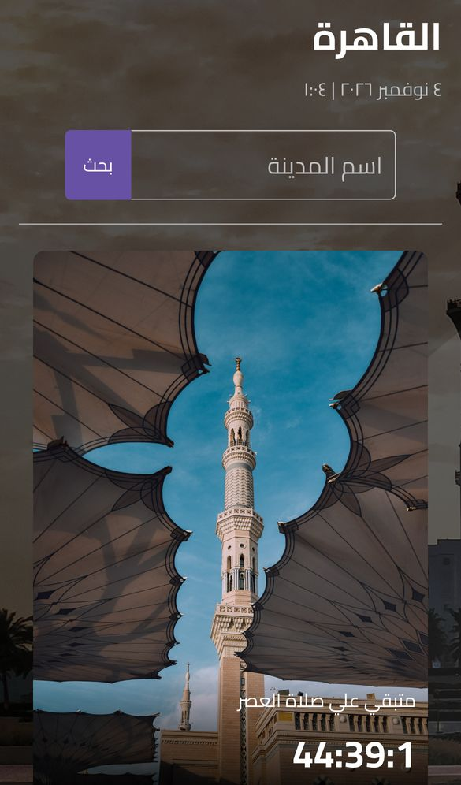
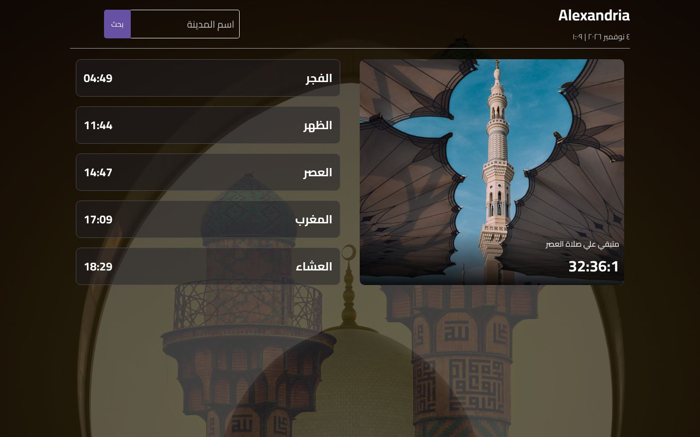

<div align="center">

# Prayer Times

### Daily Muslim prayer times with a live countdown, in Arabic (RTL)

A small React + TypeScript app that loads today's five prayer times for any city from the Aladhan API and counts down to the next prayer. The interface is in Arabic and laid out right-to-left.

[](https://react.dev)
[](https://www.typescriptlang.org)
[](https://vitejs.dev)
[](https://mui.com)
[](https://axios-http.com)
[](https://momentjs.com)
<br>
[](https://65452b9c868717229dab4a94--glittery-dango-a5ae2c.netlify.app/)

**[Live demo](https://65452b9c868717229dab4a94--glittery-dango-a5ae2c.netlify.app/)** ·
**[Portfolio](https://new-portfolio-ashy-xi.vercel.app/)** ·
**[LinkedIn](https://www.linkedin.com/in/eslamraafat-dev/)** ·
**[Email](mailto:eslamraafat736@gmail.com)**

<br>



</div>

<table>
  <tr>
    <td width="33%"></td>
    <td width="67%"></td>
  </tr>
  <tr>
    <td align="center"><sub>Mobile (iPhone 13)</sub></td>
    <td align="center"><sub>City search: results for Alexandria</sub></td>
  </tr>
</table>

---

## Overview

This is a **practice project** from my 2023 front-end training. I built it to practise:

- calling a public REST API with **Axios** and mapping the response into React state,
- working with times and durations in **Moment.js** (with the Arabic locale),
- laying out a UI with **Material UI** components (`Grid2`, `Stack`, `Divider`, `Container`),
- writing an **Arabic, right-to-left** interface,
- typing React components with **TypeScript**.

## Features

- **Today's prayer times.** On load, the app requests today's timings for Cairo (القاهرة) from the [Aladhan API](https://aladhan.com/prayer-times-api) (`/v1/timingsByAddress`) and shows Fajr, Dhuhr, Asr, Maghrib and Isha.
- **Search by city.** Type a city name and submit the form to load that city's timings. An empty search shows an alert and keeps the current city.
- **Error state with retry.** If a city can't be found or the request fails, the app shows an error message with a **Retry** button (and a button to go back to the last city that loaded) instead of an endless loader.
- **Next-prayer countdown.** A card shows the name of the next prayer and an `HH:MM:SS` timer that updates every second; the next prayer is also highlighted in the list. After Isha it counts down to the next day's Fajr.
- **Arabic date.** The current date is formatted with Moment.js in the Arabic locale.
- **Animated background.** The page background cycles through mosque photos with a CSS keyframe animation.
- **Responsive layout.** Media queries stack the search form and the cards into one column on small screens.
- A CSS loading spinner shows while data is being fetched.
- Background photos are resized to at most 1920 px wide and recompressed (about 10 MB of images down to 1.8 MB).

## Tech stack

| Layer | Tools |
| --- | --- |
| UI library | React 18.2 |
| Language | TypeScript 5 |
| Build tool | Vite 4 |
| Components | Material UI 5.14 (with Emotion) |
| Data | Axios 1.5, Aladhan prayer-times API |
| Dates | Moment.js 2.29 (Arabic locale) |
| Font | Cairo (Google Fonts) |
| Hosting | Netlify |

## Project structure

```text
.
├── index.html
├── public/
│   └── favicon.ico
└── src/
    ├── main.tsx
    ├── App.tsx                  # MUI Container around the main view
    ├── index.css                # theme variables, RTL layout, background animation, media queries
    ├── assets/                  # background and card photos
    ├── lib/
    │   └── nextPrayer.ts        # pure next-prayer / countdown calculation
    └── components/
        ├── MainContent.tsx      # API calls, city search, loading/error states
        ├── ImageCard.tsx        # "next prayer" card with the timer
        └── Prayer.tsx           # one row: prayer name + time
tests/
└── nextPrayer.test.ts           # node:test unit tests for the countdown logic
```

## Getting started

**Requirements:** Node.js 22 or newer and npm.

```bash
git clone https://github.com/Eslamraafat1/Prayer-time.git
cd Prayer-time
npm install
npm run dev        # http://localhost:5173
```

| Command | What it does |
| --- | --- |
| `npm run dev` | Start the Vite dev server |
| `npm run build` | Type-check with `tsc`, then build to `dist/` |
| `npm run preview` | Serve the production build locally |
| `npm run lint` | Run ESLint |
| `npm test` | Run the unit tests for the next-prayer logic (`node:test`, no extra dependencies) |

No API key is needed: the Aladhan API is public.

## Deployment

The app is deployed on **Netlify** as a static Vite build: [live demo](https://65452b9c868717229dab4a94--glittery-dango-a5ae2c.netlify.app/).

## Testing

`tests/nextPrayer.test.ts` has 8 unit tests for the pure `getNextPrayer` / `formatCountdown` functions in `src/lib/nextPrayer.ts`: before Fajr, between prayers, exactly at a prayer time, **after Isha (counts down to the next day's Fajr)**, just before midnight, timezone-suffixed times and zero-padding. Run them with `npm test`.

## Known limitations

- After Isha, the countdown uses **today's** Fajr time as the next day's Fajr (they usually differ by about a minute).
- The countdown uses your device's clock and time zone. If you search a city in a different time zone, its prayer times are shown in that city's local time, but the countdown is not adjusted.
- The date under the city name is set when the page loads and isn't refreshed while the page stays open.

## Author

**Eslam Raafat** — Front-End Developer (React · Next.js · TypeScript)

- **Portfolio:** [new-portfolio-ashy-xi.vercel.app](https://new-portfolio-ashy-xi.vercel.app/)
- **LinkedIn:** [linkedin.com/in/eslamraafat-dev](https://www.linkedin.com/in/eslamraafat-dev/)
- **GitHub:** [@Eslamraafat1](https://github.com/Eslamraafat1)
- **Email:** [eslamraafat736@gmail.com](mailto:eslamraafat736@gmail.com)
